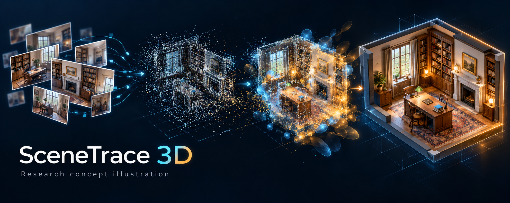
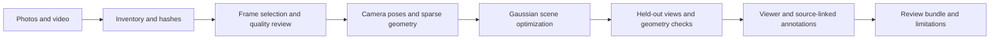

# SceneTrace 3D

### DL / Computer Vision — Forensic & Historical Scene Reconstruction



*AI-generated project concept illustration; not a reconstruction result, evidence image, or working application screenshot.*

**SceneTrace 3D** is a proposed research agent for organizing limited photographs and video clips into navigable 3D representations of crime scenes and historical locations using **3D Gaussian Splatting (3DGS)**. Its intended role is to help investigators and researchers inspect spatial relationships, compare viewpoints, and track how a reconstruction relates to its source material.

> **Status: documentation and design concept.** This repository currently contains the project specification and illustration. It does not contain a working reconstruction agent, trained model, viewer, benchmark results, or validated forensic system. Every capability described below is planned unless explicitly identified as repository content.

## Is this ML, DL, or Generative AI?

**Portfolio category: DL / Computer Vision / 3D Reconstruction.** Deep learning is a subset of machine learning, so ML also applies broadly. The planned system may use learned image features or depth priors alongside differentiable scene optimization.

There is an important technical distinction: original 3DGS directly optimizes explicit Gaussian scene parameters through differentiable rendering; it does **not inherently require a deep neural network**. A version built only from classical structure-from-motion and original 3DGS is more precisely described as **computer vision and differentiable rendering**. The DL label describes the intended broader research direction, not an implemented neural architecture in this repository.

Novel-view synthesis generates images from new viewpoints, but this project is not primarily an LLM or text-to-3D Generative AI project. Any future generative completion must be separately labeled as a hypothesis and excluded from evidence-derived reconstruction claims.

## Problem and intended value

Scene documentation may consist of incomplete image sets, videos with blur or compression, uncertain camera parameters, and photographs taken at different times. A 3D representation could make those materials easier to explore, while a provenance record could keep the source and processing history inspectable.

Limited input does not guarantee a recoverable scene. Reliable reconstruction needs sufficient overlap, viewpoint diversity, stable visual features, and a scene that is reasonably consistent across observations. A single photograph cannot uniquely establish hidden geometry. SceneTrace should report insufficient coverage rather than fabricate missing surfaces.

## Planned use cases

- **Scene review:** inspect reconstructed spaces from alternative viewpoints and link annotations to source frames.
- **Spatial analysis:** compare visible object arrangements; enable measurements only after independent scale calibration and validation.
- **Historical research:** visualize documented architecture or locations while separating observations from interpretive restoration.
- **Training and education:** work with staged scenes, synthetic scenes, or appropriately licensed public datasets.
- **Hypothesis comparison:** maintain distinct analyst-created scenario layers with explicit assumptions and provenance.

A static reconstruction alone cannot establish an event sequence, identify a perpetrator, infer intent, or determine what happened in an unseen region. Historical event animation would require additional evidence and a separate hypothesis model.

## Proposed workflow



1. **Ingest and inventory:** preserve source bytes, record SHA-256 hashes, acquisition notes, available metadata, access permissions, and case identifiers. Hashes detect byte changes; they do not prove source authenticity or establish chain of custody on their own.
2. **Prepare derivatives:** extract timestamped frames from video, identify duplicate or blurred views, and document every transform. Keep derivative files separate from originals.
3. **Estimate cameras:** use a structure-from-motion pipeline such as COLMAP to estimate camera poses and sparse points. Review registration failures, reprojection errors, and disconnected components.
4. **Optimize the scene:** initialize Gaussian positions from sparse geometry, then optimize position, shape, opacity, and appearance against training views through differentiable rendering. Split inconsistent captures into separate reconstruction sessions.
5. **Evaluate:** reserve independent views, compare renderings to observations, and test geometry against surveyed references where available. Flag weak coverage and failed runs.
6. **Inspect and annotate:** provide a navigable viewer with source links, camera locations, observation coverage, and separate hypothesis layers.
7. **Export for review:** package configuration, software versions, hashes, input selection, logs, validation results, model artifacts, and known limitations.

## Planned agent responsibilities

The agent would coordinate explicit tools and record their outputs: inventory media, propose frame selections, run reconstruction jobs, summarize failures, assemble review materials, and request analyst decisions when a scene cannot be reliably reconstructed. It should never silently replace evidence, hide failed registrations, or present inferred content as observed fact.

## Candidate technology stack

| Layer | Proposed tools | Purpose |
| --- | --- | --- |
| Media preparation | Python, FFmpeg | Frame extraction and quality assessment |
| Camera recovery | COLMAP | Camera calibration, poses, sparse geometry |
| Reconstruction | PyTorch-compatible 3DGS implementation | Differentiable Gaussian optimization |
| Acceleration | Compatible GPU and backend toolchain | Scene optimization and rendering |
| Service layer | FastAPI | Job submission and artifact access |
| Review UI | React, Three.js, compatible splat renderer | Navigation and annotations |
| Provenance | JSON manifests, SHA-256, structured logs | Reproducible processing records |

These are design candidates, not installed or integrated dependencies. GPU memory and runtime requirements must be measured on the selected backend and representative datasets. Review each upstream license before integrating or distributing code, weights, or datasets; a research implementation may have use restrictions.

## Evaluation plan

| Question | Proposed evidence |
| --- | --- |
| Does it match unseen photographs? | Held-out-view PSNR and SSIM; optionally LPIPS with its model/version recorded |
| Is geometry accurate? | Errors against independently surveyed distances or reference geometry, after scale alignment |
| How much of the scene is supported? | Registered-camera coverage and documented unobserved regions |
| Does it work with sparse inputs? | Controlled view-count and viewpoint-diversity experiments |
| Can another analyst reproduce it? | Recorded versions, parameters, random seeds, manifests, and rerun comparisons |
| Is interactive review practical? | Measured frame rate, load time, artifact size, and GPU memory on named hardware |

No scores or performance claims are available yet. Image similarity does not establish measurement accuracy or evidentiary reliability. Coverage maps and residuals are diagnostic indicators, not calibrated probability estimates of correctness.

## Limitations and investigative use

- Sparse views, occlusions, reflective surfaces, low texture, moving objects, and lighting changes can produce incomplete or misleading renderings.
- Gaussian appearance is not automatically a watertight surface, physical simulation, or metrically accurate mesh.
- Absolute scale generally requires independently known measurements or calibrated capture information.
- Captures from different times do not necessarily describe the same scene state; do not merge them into a single asserted event without review.
- Record uncertainty, alternatives, failed processing, and source coverage alongside every reviewed reconstruction.
- Use authorized, non-sensitive demonstration media in this public repository. Store actual case material and identifying metadata in an appropriately controlled environment.
- Operational, legal, or evidentiary use would require independent validation, qualified human review, and applicable institutional procedures. This concept makes no certification or admissibility claim.

## Roadmap

- [x] Define the research scope, classification, limitations, and documentation.
- [x] Add a clearly labeled project illustration.
- [ ] Build a local media inventory and provenance manifest tool.
- [ ] Integrate frame selection and COLMAP with reproducible configuration.
- [ ] Integrate a license-reviewed 3DGS backend on a staged scene.
- [ ] Add held-out-view and independently scaled geometry evaluation.
- [ ] Build a source-linked viewer with separate hypothesis annotations.
- [ ] Conduct sparse-input experiments and publish reproducible results.
- [ ] Seek independent domain review before any operational deployment.

## Repository contents and getting started

```text
README.md                         Project specification and research plan
docs/assets/scenetrace-concept.png Concept illustration
docs/illustration-prompt.md        Illustration prompt and disclosure
.gitignore                        Excludes local media, models, and secrets
```

There is currently no installation, training, or inference command. To begin implementation, select an upstream backend and check its license, establish a staged or licensed dataset, define independent validation references, and implement the provenance tool first. Do not interpret roadmap checkboxes as implemented functionality.

## Research foundations

- Kerbl, Kopanas, Leimkühler, and Drettakis (2023), [3D Gaussian Splatting for Real-Time Radiance Field Rendering](https://arxiv.org/abs/2308.04079). The paper describes explicit Gaussian scene optimization and visibility-aware splatting.
- [COLMAP tutorial](https://colmap.github.io/tutorial.html) — camera poses and sparse scene recovery through structure-from-motion.
- [COLMAP source and documentation](https://github.com/colmap/colmap) — upstream implementation, setup information, and licensing.

This repository describes an independent project concept and does not imply endorsement by these research authors or upstream projects.
