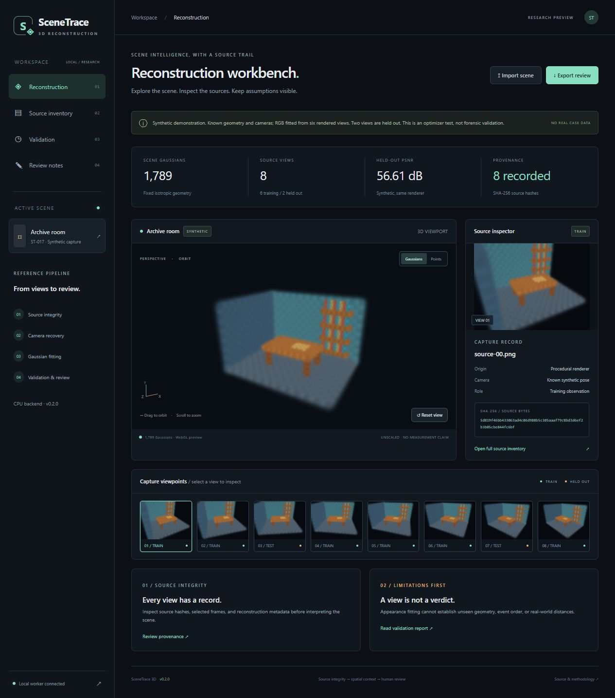
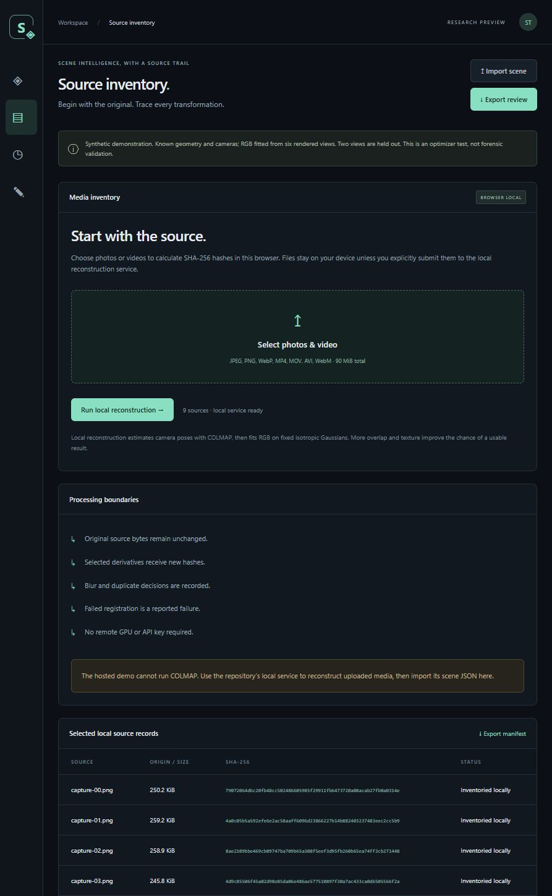
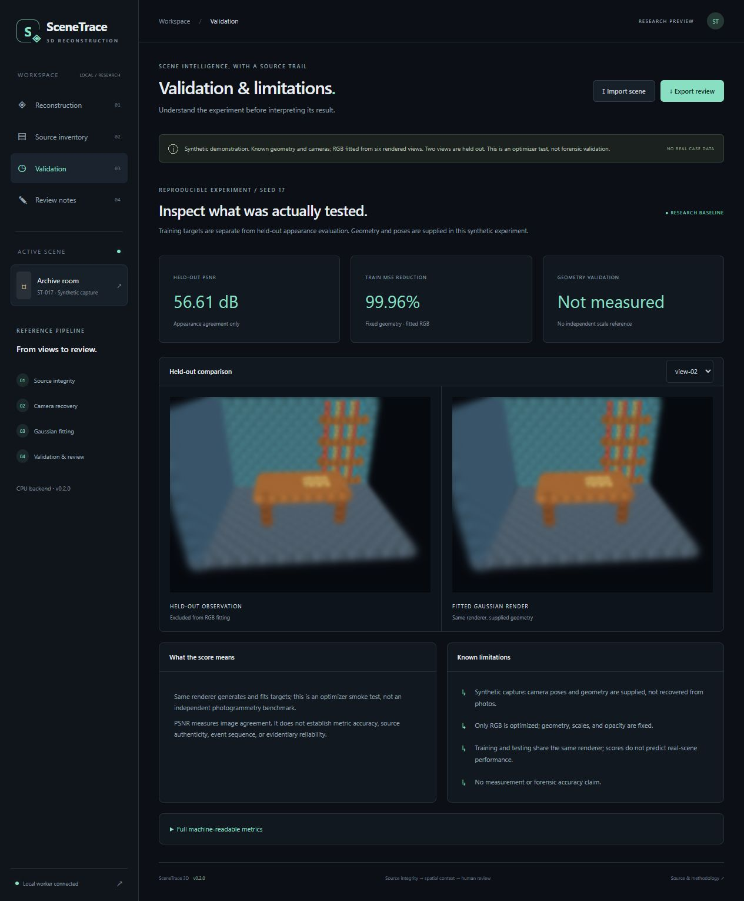
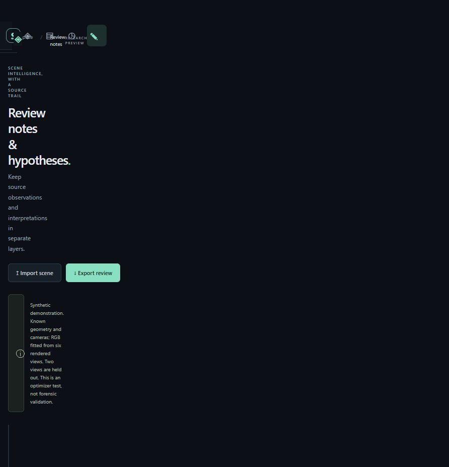
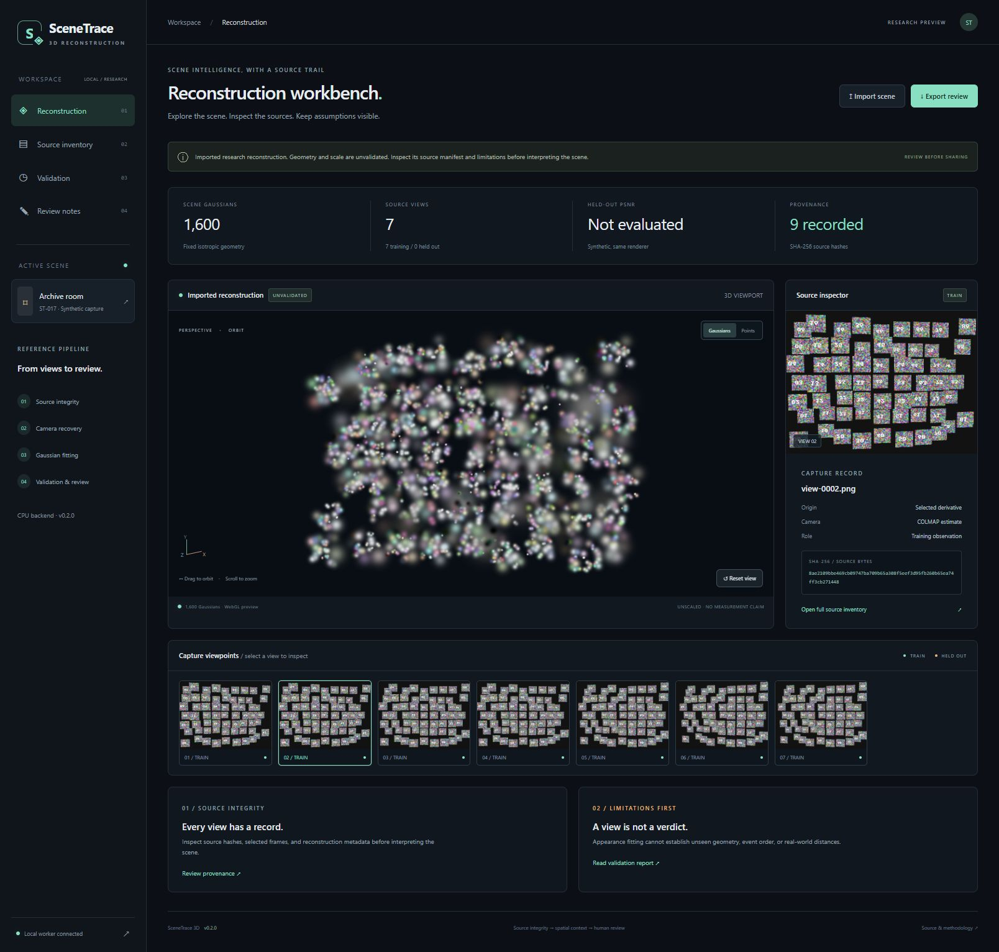
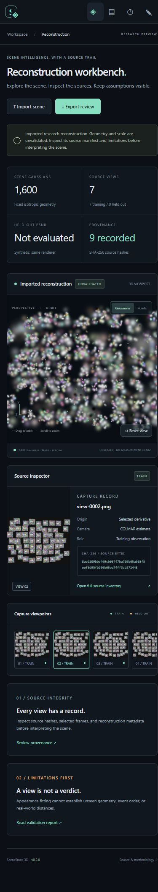

# SceneTrace 3D

### Computer Vision · Gaussian Splatting · Forensic & Historical Reconstruction Research

[Live review demo](https://scenetrace-3d-vams2krish.adam-vamshikrishna.chatgpt.site) · [Operations and security boundaries](docs/OPERATIONS.md) · [Dependency attribution](docs/THIRD_PARTY.md) · [Measured experiments](docs/experiments/sparse-input.json)

**SceneTrace 3D turns overlapping photos or video frames into a source-linked 3D research artifact.** Inventory original media, select derivatives, estimate cameras with COLMAP, fit Gaussian colors, inspect the result in a WebGL viewer, separate observations from hypotheses, and export review records.

> **Release v0.2.0: working research demo and local single-user service.** The hosted Site is a private-to-owner static review demo. Actual media reconstruction runs through the local Python service. This is not a certified forensic tool or a production-ready multiuser service. No real case data is published here.



*Actual application screenshot with a procedural synthetic Gaussian room. This is not a real scene or a photorealistic reconstruction benchmark.*

## Product showcases

### Source inventory and provenance

Choose local media, compute SHA-256 hashes, and submit explicitly to the local worker. Originals remain separate from selected image derivatives.



### Validation with held-out comparisons

Inspect the synthetic observation and fitted Gaussian render side by side, read the actual metrics, and keep evaluation caveats visible.



### Separate observation and hypothesis layers

Notes reference specific source views and persist per scene in browser storage. Both layers are included in the review JSON export.



### Actual browser-to-COLMAP output

The browser uploaded nine synthetic textured captures, the local worker recovered cameras and sparse geometry, fitted Gaussian colors, and returned this navigable artifact. The sparse appearance is an actual output limitation, not concealed by substituting the synthetic room.



### Responsive review



All showcase images above are screenshots of the running product. The [original AI-generated concept banner](docs/assets/scenetrace-concept.png) is retained separately with its [prompt and disclosure](docs/illustration-prompt.md); it is not a product result.

## What works today

| Capability | Implemented behavior |
| --- | --- |
| Source inventory | SHA-256, source-byte counts, stable source IDs, decode failure records |
| Frame preparation | JPEG/PNG/WebP; OpenCV video extraction; interval and candidate budget; normalized PNG derivatives |
| Selection decisions | Laplacian sharpness heuristic and exact normalized-pixel duplicate detection, recorded per candidate |
| Camera recovery | CPU PyCOLMAP feature extraction, exhaustive matching, incremental mapping, camera export |
| Gaussian reconstruction | Original CPU backend with fixed isotropic geometry/scales/opacity and bounded least-squares RGB fitting |
| Synthetic evaluation | Seeded 1,789-Gaussian room, six training views and two held-out views, PSNR and train MSE |
| Review UI | Orbit/zoom, point mode, camera navigation, source hashes, validation comparisons, responsive layout |
| Review notes | Source-linked observations and hypotheses; scene-specific browser persistence; removal and export |
| Local job service | One active subprocess, ten-minute deadline, persisted success/failure, review ZIP export |
| Hosted demo | Static deployment with committed synthetic artifacts, local hashing, JSON import, notes and exports |
| Verification | Eight automated tests, live browser upload-to-result run, live duplicate-input failure check, CI workflow |

## Run the demo locally

Use **Python 3.12** for the tested environment. No OpenAI key, external AI API, GPU, COLMAP executable, Node dependency installation, or FFmpeg executable is required. PyCOLMAP and OpenCV wheels supply the used functionality.

```powershell
git clone https://github.com/vams2krish/DL-SceneTrace-3D.git
cd DL-SceneTrace-3D
python -m venv .venv
.\.venv\Scripts\python.exe -m pip install -r requirements-lock.txt
.\.venv\Scripts\python.exe -m pip install --no-deps -e .
.\.venv\Scripts\python.exe -m scenetrace.cli serve
```

Open **http://127.0.0.1:8765/**. On Linux/macOS, replace `.\.venv\Scripts\python.exe` with `.venv/bin/python`.

1. Explore the synthetic room, select source thumbnails, and compare held-out views in **Validation**.
2. Add an observation and a hypothesis in **Review notes**, reload, and export the review JSON.
3. In **Source inventory**, choose 4–40 overlapping photos or a video. Up to 40 files and 90 MiB of source bytes are accepted by the local UI.
4. Submit **Run local reconstruction**. The worker requires at least four distinct, sufficiently sharp derivative views. Registration can fail when overlap or texture is inadequate.
5. Inspect the returned scene, source records, and limitations. Download the worker review bundle. Failed jobs expose their reason instead of substituting a demo scene.

The hosted Site runs the review functions without a Python server. Its reconstruction control remains unavailable; it does not upload files or run COLMAP in the cloud. Scene JSON can be imported there, but its relative source-image links require the local service or a corresponding artifact directory; imported JSON does not embed source media. This release accepts its own schema, not arbitrary `.ply` or `.splat` files.

## Reproduce the complete synthetic photo pipeline

```powershell
# Make perspective photographs of textured synthetic 3D patches.
.\.venv\Scripts\python.exe scripts/generate_sfm_fixture.py data/sfm-input

# Inventory only, with explicit derivative selection parameters.
.\.venv\Scripts\python.exe -m scenetrace.cli inventory data/sfm-input data/inventory-run --max-frames 40

# Recover cameras and geometry from pixels, then fit Gaussian RGB.
.\.venv\Scripts\python.exe -m scenetrace.cli reconstruct data/sfm-input data/reconstruction-run

# Independently regenerate the supplied-camera appearance-fitting demo.
.\.venv\Scripts\python.exe -m scenetrace.cli demo data/gaussian-demo-run

# Controlled 4/6/9-view experiment; work directory must be new.
.\.venv\Scripts\python.exe scripts/sparse_experiment.py --work data/experiment-new

# With the local server running: verify a real subprocess failure and queue release.
.\.venv\Scripts\python.exe scripts/verify_local_api.py

.\.venv\Scripts\python.exe -m pytest -q
```

Outputs are never silently overwritten by the inventory/reconstruction commands; choose a new output directory for reruns. The Gaussian demo command regenerates its explicitly selected demo destination. CLI inventory supports `--interval` in seconds and `--max-frames` (candidate budget, including rejected candidates).

## Measured output

### Gaussian optimizer experiment

| Measurement | Observed result |
| --- | --- |
| Scene | Procedural archive room; seed 17 |
| Gaussians | 1,789 |
| Training / held-out views | 6 / 2 |
| Training MSE before → after | 0.00379316 → 0.00000158 |
| Mean held-out PSNR | 56.61 dB |
| RGB solver success | All three channels |

See [committed metrics](demo/dist/sample/metrics.json), [scene artifact](demo/dist/sample/scene.json), and [generator](scenetrace/demo.py).

**Interpretation:** cameras, geometry, scale, and opacity are supplied by the synthetic generator. Only colors are fitted. The same renderer generates and evaluates observations; the score is an optimizer smoke test and does not predict real-scene reconstruction quality.

### Camera recovery from rendered photographs

These experiments use a separate seed-21 textured 3D-patch fixture. Camera poses are estimated from the image pixels through COLMAP; ground-truth poses are not passed to reconstruction.

| Input captures | Cameras registered | Triangulated points | Train MSE after RGB fit |
| --- | --- | --- | --- |
| 4 | 4 | 4,934 | 0.04153 |
| 6 | 6 | 7,444 | 0.03261 |
| 9 | 7 | 8,521 | 0.02922 |

The nine-view run excludes two images from both SfM and fitting. Independent localization of those held-out images is not implemented, so no held-out score is claimed for these reconstructions. Four/six-view runs use all selected views. The [full report](docs/experiments/sparse-input.json) includes runtime and similarity-aligned camera-center diagnostics. Alignment is fitted to the same training camera centers; it is not independent geometry validation. Timings depend on the host and are not throughput claims.

A separate live browser run also registered seven cameras from nine uploaded synthetic images and produced a downloadable worker bundle. [Live duplicate-media failure report](docs/experiments/api-failure.json) verifies that inadequate distinct views fail explicitly and release the worker slot.

## How reconstruction works

```mermaid
flowchart LR
    A[Original photos or videos] --> B[SHA-256 inventory]
    B --> C[Frame derivatives and quality decisions]
    C --> D[CPU COLMAP camera and sparse point recovery]
    D --> E[Fixed isotropic Gaussian initialization]
    E --> F[Bounded least-squares RGB fitting]
    F --> G[Scene JSON and validation records]
    G --> H[WebGL review and source-linked notes]
    H --> I[Review JSON or worker ZIP]
```



The CPU backend projects Gaussian centers, approximates screen-space isotropic footprints, sorts by depth, and composites front to back. With positions, scales, and opacity fixed, pixel color is linear in Gaussian RGB, so bounded sparse least squares can fit appearance without a neural network or CUDA. A small color prior stabilizes weakly observed splats.

It does **not** optimize Gaussian positions, full covariance, opacity, spherical harmonics, or adaptive densification. The WebGL preview uses depth-sorted point sprites and is approximate; CPU render outputs are used for reported evaluation. Photo reconstruction is capped at 1,600 splats and fitted at 96×96, so it is a small research baseline with visibly incomplete detail.

## Is it ML, DL, or Generative AI?

The implemented release is **computer vision + numerical optimization + differentiable-rendering-inspired Gaussian splatting**. It contains no trained deep neural network, pretrained weights, LLM, or Generative AI scene completion. The `DL-SceneTrace-3D` repository name preserves the original proposed DL direction; **DL extensions remain roadmap work**.

Original 3D Gaussian Splatting optimizes an explicit scene representation and does not inherently require a deep network. Novel-view synthesis is not evidence of hidden geometry or event history. Any future learned depth/features or generative hypothesis layers must be identified and evaluated separately.

## Data, provenance, and limits

- Hashes detect changes in bytes; they do not authenticate the source or establish chain of custody.
- Source media stays separate from normalized derivatives. Available source content is not silently altered.
- Sharpness and coverage diagnostics are heuristics, not calibrated correctness probabilities.
- Static scene capture cannot establish event sequence, intent, identity, or what happened outside observed areas.
- Real-world scale and measurement accuracy require independent references. Gaussian appearance is not a validated physical surface or watertight mesh.
- Moving objects, reflective surfaces, weak texture, and inconsistent capture times can invalidate reconstruction assumptions.
- Do not publish actual case files or identifying metadata. `data/`, media outputs, local secrets, and model files are ignored by Git.
- The local worker ZIP contains review JSON and submitted-name mapping; originals, derivative images, worker logs, and COLMAP binary files stay in the local job directory.
- Browser notes are local, removable, and exportable; this is not a tamper-evident evidence management system.

Read [OPERATIONS.md](docs/OPERATIONS.md) for implemented controls, recovery, retention, and production release gates. The loopback service must not be exposed as a public multiuser backend.

## Roadmap and release boundary

- [x] Source inventory and original-media hashing.
- [x] Still/video derivative selection with recorded blur and duplicate decisions.
- [x] Reproducible CPU COLMAP integration and failure reporting.
- [x] Original license-independent CPU Gaussian RGB baseline and staged synthetic demo.
- [x] Held-out appearance evaluation for supplied synthetic cameras.
- [x] Source-linked WebGL review, separate hypothesis notes, and exports.
- [x] Controlled sparse-input experiments on synthetic photographs.
- [x] Automated checks, live browser flow, real screenshots, and hosted review demo.
- [ ] Full anisotropic Gaussian geometry/opacity optimization and densification.
- [ ] Independent held-out camera localization for uploaded scenes.
- [ ] Surveyed scale, independent geometry evaluation, and calibrated uncertainty.
- [ ] Optional learned features/depth with explicit DL evaluation.
- [ ] Persistent authenticated multiuser case storage, sandboxed GPU workers, access auditing, backups, and retention controls.
- [ ] Independent security/accessibility review and real-data performance evaluation.
- [ ] Qualified forensic review before operational or evidentiary use.

## Repository map

```text
scenetrace/             Media inventory, COLMAP pipeline, Gaussian backend, CLI, API
scripts/                Synthetic generators, sparse experiment, live failure check
tests/                  Integrity, media, numerical, API, and export tests
demo/dist/              Dependency-free hosted/browser application and sample artifacts
demo/.openai/           Sites hosting identity and static deployment configuration
docs/showcase/          Six screenshots of the running application
docs/experiments/       Actual sparse-input results and live failure report
docs/OPERATIONS.md      Local service boundaries and production release gates
requirements-lock.txt   Exact tested Python dependency versions
.github/workflows/      CI checks for code and tests
```

## Research foundations

- Kerbl, Kopanas, Leimkühler, and Drettakis (2023), [3D Gaussian Splatting for Real-Time Radiance Field Rendering](https://arxiv.org/abs/2308.04079).
- [COLMAP tutorial](https://colmap.github.io/tutorial.html) and [PyCOLMAP documentation](https://colmap.github.io/pycolmap/index.html).
- [Upstream source attribution and integration notes](docs/THIRD_PARTY.md).

This is an independent research project. No certification, upstream endorsement, or admissibility claim is made.
